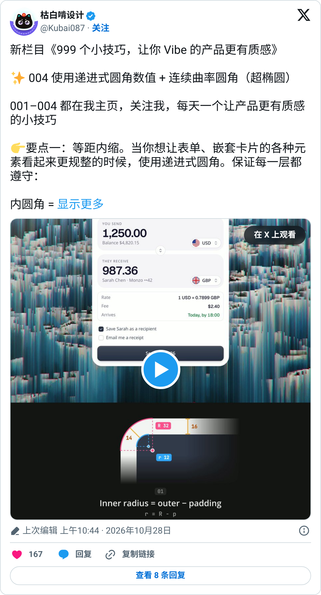
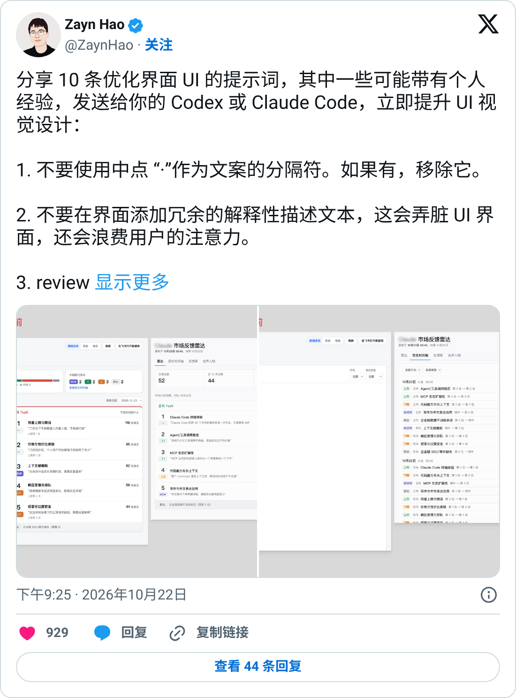
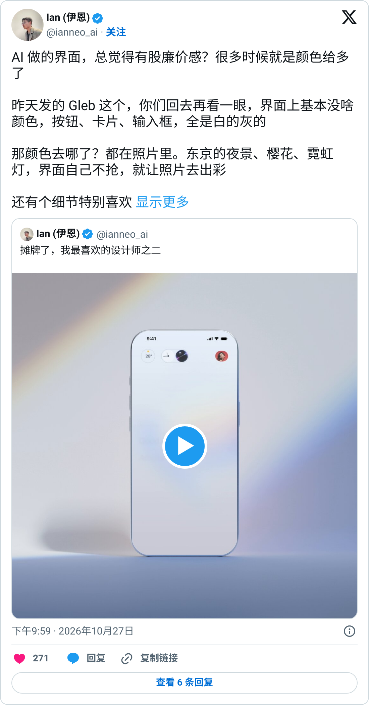
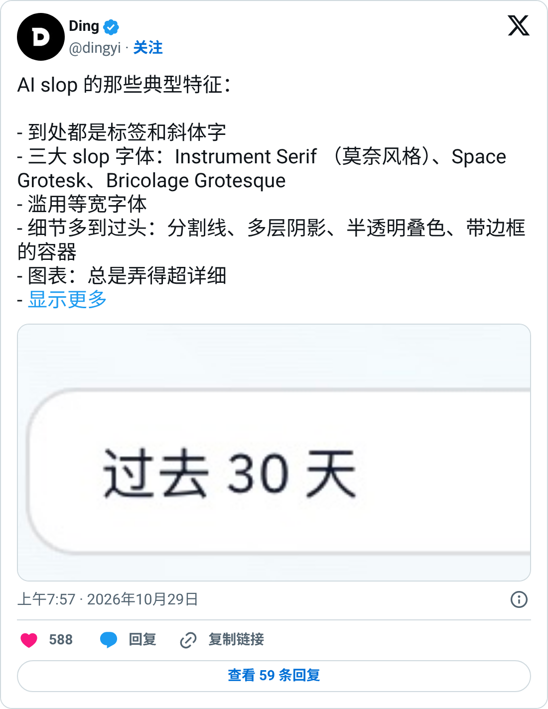
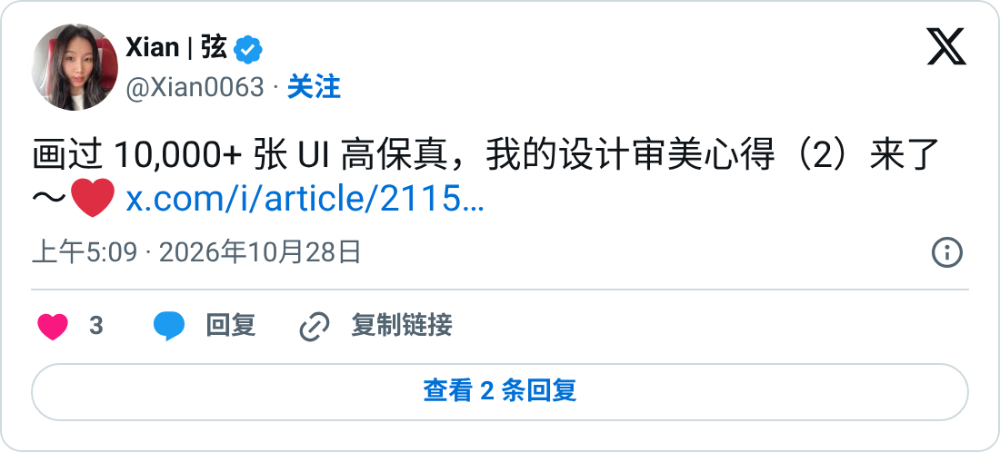
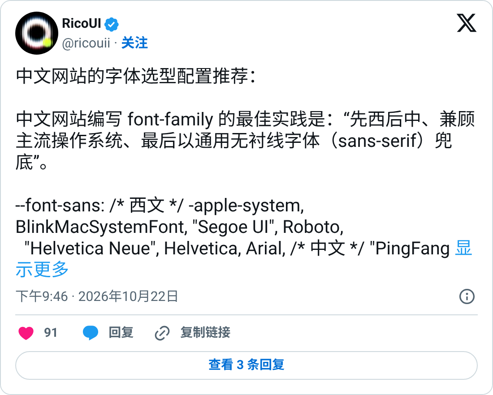
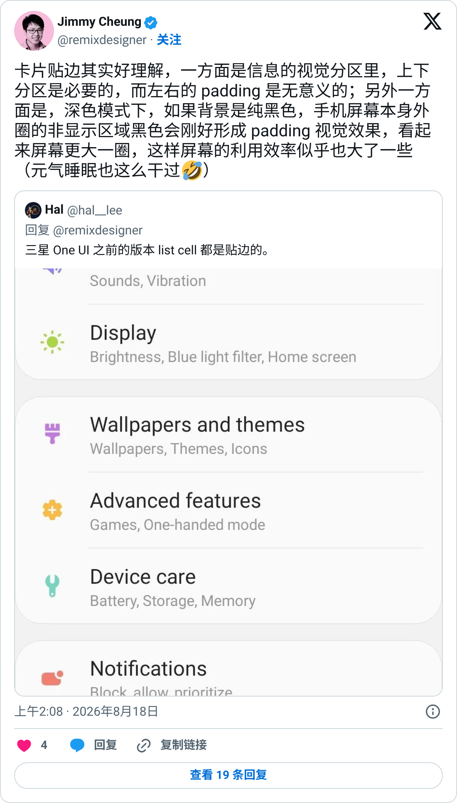

# vibe-ui-polish

一个给 AI 编码 agent 用的 skill，用来优化和审查 AI 生成（vibe coding）的前端界面。它会先找出并删掉“AI 味”（紫色渐变、卡片左侧彩色竖线、标题 emoji、假数据等），再按间距、嵌套圆角、字体、颜色、阴影、按钮、图标、动效、文案、空状态和移动端逐项打磨，最后给出一份审查清单和可以直接复制给 Codex / Claude Code 的提示词。

> 本 skill 的内容整理、转述自 8 位设计师在 X 上公开发布的帖子，详见下方 [来源与致谢](#来源与致谢)。

## 安装

把整个文件夹放进你的 agent 的 skills 目录即可。

**Claude Code**

```bash
git clone https://github.com/Anthonyma0706/vibe-ui-polish ~/.claude/skills/vibe-ui-polish
```

**Cursor**（放在项目里）

```bash
git clone https://github.com/Anthonyma0706/vibe-ui-polish .cursor/skills/vibe-ui-polish
```

**Codex 或其他支持 `SKILL.md` 的 agent**

```bash
git clone https://github.com/Anthonyma0706/vibe-ui-polish ~/.codex/skills/vibe-ui-polish
```

装好后，对 agent 说“用 vibe-ui-polish 优化一下这个页面”或“按 vibe-ui-polish 审查首页”就会触发。

## 内容一览

| 文件 | 说明 |
| --- | --- |
| [`SKILL.md`](SKILL.md) | skill 本体 |
| [`sources.md`](sources.md) | 用到的全部原帖链接（8 位设计师的 40 条帖子，外加 @bruc3van 的总帖），每条附一句要点 |
| [`screenshots/`](screenshots/) | 下方致谢里用到的 X 帖子截图 |

`SKILL.md` 的结构：

0. 总原则：先做判断，再做减法
1. AI 味清单：先找出来，再删掉
2. 间距与布局
3. 嵌套圆角（内圆角 = 外圆角 − 内边距）
4. 字体与排版
5. 颜色
6. 阴影与边框
7. 按钮
8. 图标
9. 动效
10. 文案
11. 状态：空、错、加载
12. 响应式与移动端
13. 审查清单
14. 现成提示词（直接复制给 Codex / Claude Code）
15. 资源
16. 致谢与出处

## 来源与致谢

这个 skill 的灵感来自 [@bruc3van](https://x.com/bruc3van) 的[这条帖子](https://x.com/bruc3van/status/2115963644811116732)，他推荐了 8 位一直在拆解“AI 界面哪里露馅、该怎么跟 AI 说”的中文设计师。下面的规则都是从这 8 位设计师公开发布的 X 帖子中整理、转述而来，`SKILL.md` 中每条规则后的【】标注了出处。

**原始内容的版权归各位原作者所有。** 本仓库只做了整理和结构化（by [@Anthonyma0706](https://github.com/Anthonyma0706)），不主张对原始内容的任何权利。想了解完整内容，请去原帖阅读并关注作者。

<p></p>

### 1. 枯白啃设计 [@Kubai087](https://x.com/Kubai087)

App 图标设计师，日更《999 个小技巧，让你 Vibe 的产品更有质感》。本 skill 中的嵌套圆角、触感按钮、级联菜单、拖拽排序、AI 图标修正、Bento 动画和 SVG 空状态都来自他。

用到的帖子：[001 触感按钮](https://x.com/Kubai087/status/2114378773655326873)、[002 级联菜单](https://x.com/Kubai087/status/2114729985143677258)、[003 Dither/ASCII](https://x.com/Kubai087/status/2115091203465290087)、[004 嵌套圆角](https://x.com/Kubai087/status/2115469767650021796)、[004 补充](https://x.com/Kubai087/status/2115640858091598244)、[005 拖拽排序](https://x.com/Kubai087/status/2115823717024735708)、[修 AI 图标](https://x.com/Kubai087/status/2115674219602452656)、[Bento 动画](https://x.com/Kubai087/status/2115393082472681875)、[SVG 空状态](https://x.com/Kubai087/status/2113849121299894727)

<p></p>

### 2. Zayn Hao [@ZaynHao](https://x.com/ZaynHao)

分享了 10 条可以直接发给 Codex / Claude Code 的 UI 优化提示词（不用“·”分隔、0.5px 边框、字号不超过 4 种、ease-out 250ms 等），以及配色规范。

用到的帖子：[10 条提示词](https://x.com/ZaynHao/status/2113456751915982917)、[补充：要多轮细调](https://x.com/ZaynHao/status/2113482619480690729)、[配色与字号](https://x.com/ZaynHao/status/2111685618925474098)

<p></p>

### 3. 伊恩 Ian [@ianneo_ai](https://x.com/ianneo_ai)

关注颜色克制、细节审查、按产品类型定风格，以及“AI 负责加，你负责减”。

用到的帖子：[颜色太多显廉价](https://x.com/ianneo_ai/status/2115277214149451968)、[细节审查](https://x.com/ianneo_ai/status/2116073925507793219)、[按产品定风格](https://x.com/ianneo_ai/status/2116077464665612498)、[喂组件库给 AI](https://x.com/ianneo_ai/status/2115807235108712540)、[文章：AI 越强，你的判断越值钱](https://x.com/ianneo_ai/status/2115633169101983932)、[10 条老规矩](https://x.com/ianneo_ai/status/2115324574145400996)、[别抄 AI 模板](https://x.com/ianneo_ai/status/2113554071017980277)、[噪点渐变](https://x.com/ianneo_ai/status/2113225499556381172)、[立体线框图标](https://x.com/ianneo_ai/status/2113834027044245686)、[批量素材一致性](https://x.com/ianneo_ai/status/2114560719840813392)、[Deji 个站](https://x.com/ianneo_ai/status/2109446065632211186)、[氛围效果](https://x.com/ianneo_ai/status/2107784007933124670)

<p></p>

### 4. 丁一 Ding [@dingyi](https://x.com/dingyi)

总结了 AI slop 的典型特征（滥用标签和斜体、三大 slop 字体、等宽字体、多层阴影、下拉小箭头等）。

用到的帖子：[AI slop 典型特征](https://x.com/dingyi/status/2115790005423734818)、[流行风格泛滥](https://x.com/dingyi/status/2115427867618328981)

<p></p>

### 5. 弦 Xian [@Xian0063](https://x.com/Xian0063)

两篇设计审美长文：AI 味的来源，以及“美术方向 → 规范 → 截图自查 2–4 轮”的三步法；另有 46 个可复制给 AI 的前端动效。

用到的帖子：[审美心得（1）](https://x.com/Xian0063/status/2114306504778256445)、[审美心得（2）](https://x.com/Xian0063/status/2115385391373324775)、[46 个前端动效](https://x.com/Xian0063/status/2115668536798691575)

<p></p>

### 6. 妍妍 Dreameryanyan [@yanliudreamer](https://x.com/yanliudreamer)

关于如何用 AI 做设计（从全局出发、做减法、一次出 3–4 个方案、用设计系统），Taste 的四种能力，以及 10 个 UI 工具库推荐。

用到的帖子：[10 个 UI 组件工具库](https://x.com/yanliudreamer/status/2113188741452103685)、[如何用 AI 设计](https://x.com/yanliudreamer/status/2115228047594971475)、[Taste 的四种能力](https://x.com/yanliudreamer/status/2109193283389751789)、[替用户消灭选择](https://x.com/yanliudreamer/status/2113509905881829868)

<p></p>

### 7. RicoUI [@ricouii](https://x.com/ricouii)

中文网站字体栈的写法（先西后中、兼顾主流系统、最后用 sans-serif 兜底），以及用新字体减少“AI 页面感”。

用到的帖子：[中文网站字体栈](https://x.com/ricouii/status/2113462025556996412)、[Leon Sans 2.0](https://x.com/ricouii/status/2112355870525080041)、[Dither/ASCII 流行](https://x.com/ricouii/status/2115266934338121860)

<p></p>

### 8. Remix / Jimmy Cheung [@remixdesigner](https://x.com/remixdesigner)

Remix Icon 作者。本 skill 用到了他关于移动端卡片贴边、图标 Clear 模式和基础交互体验的观点。

用到的帖子：[Preview 图标的 Clear 图层](https://x.com/remixdesigner/status/2100082157184229741)、[移动端卡片贴边](https://x.com/remixdesigner/status/2089610327730290994)、[dmg 安装体验](https://x.com/remixdesigner/status/2075415299587993934)、[读 Material Design guideline](https://x.com/remixdesigner/status/2088197553552797950)

<p></p>

### 说明

- 截图是用 X 官方嵌入组件（`platform.twitter.com` 的 Tweet embed）渲染后截取的，截图时间为 2026-10-30。
- 全部 40 条帖子的链接和要点见 [`sources.md`](sources.md)。
- 整理时只读取了帖子的文字。帖子里的图片和视频（例如配图里的提示词、动效视频）没有读取，X 长文也只读到前半部分，所以 skill 可能漏掉了一些内容，建议去原帖查看完整版本。
- 转述难免有偏差，以原帖为准。

**如果你是原作者，希望删除或修改与你有关的内容，请[提 issue](https://github.com/Anthonyma0706/vibe-ui-polish/issues)，我会尽快处理。**
